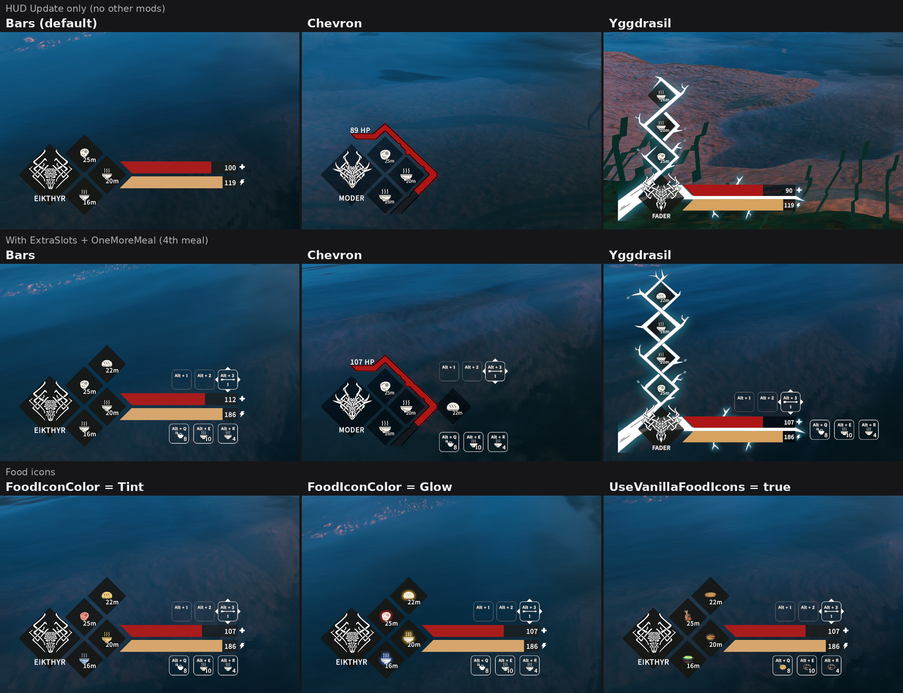
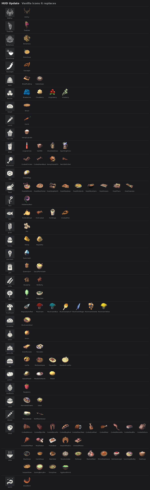

# HUD Update

A client-side Nordic HUD for Valheim by Crevitka. Guardian power, food timers, health and stamina in a compact layout.

## Version 0.2.0

Early release. The final 0.2.0 package still needs in-game verification across all three styles. See CHANGELOG.md for changes.

## Screenshots

Top row: `HudStyle = Bars`, `Chevron`, `Yggdrasil` with no other mods. Middle row: the same styles with the optional **ExtraSlots** integration and a 4th meal from **OneMoreMeal**. Bottom row: `FoodIconColor = Tint`, `Glow` and `UseVanillaFoodIcons = true`.

All food icons next to the vanilla ones they replace

## Features

- **Bars:** slanted health and stamina bars with readable value plates.
- **Chevron:** food diamonds framed by a red health chevron. An optional stamina strip is available; vanilla stamina is used by default.
- **Yggdrasil:** a branch frame with vertically arranged food diamonds and resource bars to the right.
- Seven guardian emblems: Eikthyr, The Elder, Bonemass, Moder, Yagluth, the Queen and Fader.
- Flat food icons, timers and a reminder pulse when food can be eaten again. Optional stat tint/glow.
- Support for a fourth meal when provided by a compatible mod such as OneMoreMeal.
- Optional **ExtraSlots** integration: styled ammo, food and quick slots. Food counts match the timer size; empty ammo slots have faint borders. In Bars, food and ammo rows align with the right edge of the resource bars.
- Adjustable HUD size, diamond opacity and percentage/absolute resource bar scaling.

## Installation

Requires BepInExPack Valheim. Install with your mod manager, or extract the Nexus/manual archive into the Valheim folder. The resulting plugin path is `BepInEx/plugins/HUD-Update/HUD-Update.dll`.

When updating, remove any older standalone `BepInEx/plugins/HUD-Update.dll` so only one copy loads. Preserve your personal configuration. ExtraSlots and OneMoreMeal are optional and are not bundled.

## Configuration

Edit `BepInEx/config/crevitka.hudupdate.cfg`; changes reload in game.

| Section | Setting | Default |
|---|---|---|
| General | HudStyle: Bars, Chevron, Yggdrasil | Bars |
| General | HudScale: 0.5–2 | 1 |
| Bars | BarScale: Percent, Absolute | Percent |
| Bars | HealthBarMax / StaminaBarMax | 200 / 200 |
| Bars | DiamondOpacity: 0–1 | 0.93 |
| Bars | BarBackgroundOpacity: 0–1 | 0.75 |
| Chevron | StaminaInChevron | false |
| Yggdrasil | GlowStrength: 0–1 | 0.25 |
| Compatibility | ExtraSlotsLayout: Auto, Off | Auto |
| Food | UseVanillaFoodIcons | false |
| Food | FoodIconColor: Off, Tint, Glow, TintAndGlow | Off |
| Food | FoodGlowStrength: 0–1 | 0.7 |

ExtraSlots controls slot availability, progression and shortcuts in its own configuration. HUD Update changes their appearance and placement. Set ExtraSlotsLayout to Off to restore ExtraSlots presentation.

## Custom icons

PNG files in `BepInEx/plugins/HUD-Update/Icons` can be replaced and reload in game. Keep personal replacements in `BepInEx/config/HUD-Update/Icons` to preserve them across updates; this folder takes priority. Built-in copies provide a fallback.

Guardian filenames: Eikthyr.png, TheElder.png, Bonemass.png, GP_Moder.png, GP_Yagluth.png, GP_Queen.png and GP_Fader.png. See Icons/README.txt for other filenames. Use transparent square PNGs.

## Compatibility and limitations

- Install on the client; no server installation is required.
- Other mods that replace the same HUD elements may conflict.
- A custom **Eitr bar is not implemented** in this release.
- Chevron stamina styling is still being refined; the generated redesign concepts are not included.
- Fonts may differ from concept artwork. Test your resolution and UI scale.

## Credits

Author: **Crevitka**. Original Eikthyr, The Elder and Bonemass emblems: **𝗛คηɗץ**. Moder, Yagluth, Queen and Fader emblems generated with AI assistance. Developed with AI assistance. MIT License; see LICENSE.

BarBackgroundOpacity controls the dark backgrounds and value plates of health/stamina bars in Bars and Yggdrasil. Coloured fills and text are unaffected; changes apply in game. It does not affect Chevron.

Set [Food] UseVanillaFoodIcons = true to show original food item icons in the food diamonds and ExtraSlots food slots. This also preserves modded food icons. No PNG files need to be deleted. Guardian emblems are unaffected; set false to restore HUD Update icons. Changes apply live.
