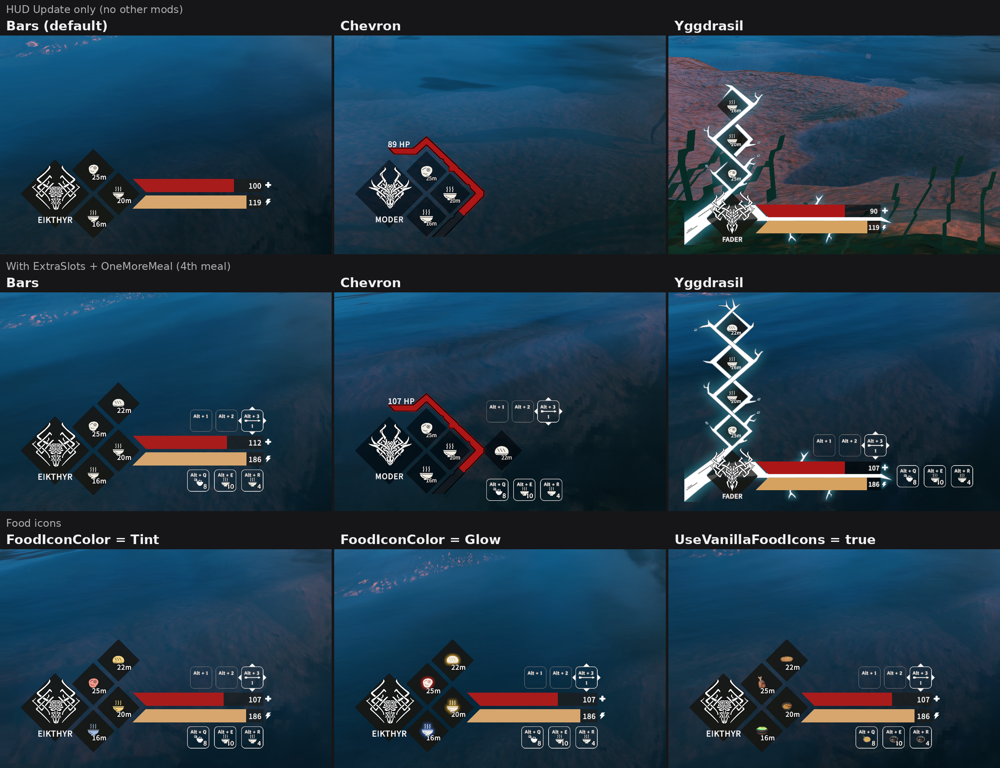

# HUD Update 0.2.0

Клиентский HUD для Valheim от Crevitka. Три режима: Bars, Chevron и Yggdrasil; семь иконок боссов, таймеры еды, здоровье и стамина.

## Скриншоты

Верхний ряд: `HudStyle = Bars`, `Chevron`, `Yggdrasil` без других модов. Средний ряд: те же стили с интеграцией **ExtraSlots** и четвёртым блюдом от **OneMoreMeal**. Нижний ряд: `FoodIconColor = Tint`, `Glow` и `UseVanillaFoodIcons = true`.

## Что нового

- Yggdrasil и поддержка четвёртого блюда, добавленного совместимым модом (например, OneMoreMeal).
- Иконки Модер, Яглута, Королевы и Фейдера с тёмной обводкой.
- Оформление ExtraSlots: крупнее количество еды, отступ справа, лёгкие рамки пустых слотов стрел.
- В Bars ряды еды и стрел выровнены по правому краю полос.
- Масштаб HUD, прозрачность ромбов, относительное/абсолютное заполнение полос и опциональная стамина Chevron.

## Установка

Нужен BepInExPack Valheim. Архив Nexus распаковать в папку Valheim; Thunderstore-архив предназначен для менеджера модов. DLL должна оказаться в BepInEx/plugins/HUD-Update/HUD-Update.dll.

При обновлении убери старую отдельную BepInEx/plugins/HUD-Update.dll, если она есть, чтобы не загрузить две копии. Личные конфиги сохраняй. ExtraSlots и OneMoreMeal необязательны и в комплект не входят.

## Настройки

BepInEx/config/crevitka.hudupdate.cfg. Изменения подхватываются в игре. HudStyle: Bars, Chevron или Yggdrasil; HudScale: 0.5–2. ExtraSlotsLayout = Off возвращает оформление ExtraSlots. Условия открытия слотов и горячие клавиши задаются в конфиге самого ExtraSlots.

Личные PNG-иконки помещай в BepInEx/config/HUD-Update/Icons: они имеют приоритет и сохраняются при обновлении. Встроенные иконки служат запасным вариантом. Полный список настроек — в README.md.

## Ограничения

Собственная полоса эйтра ещё не реализована. Новый дизайн стамины Chevron остаётся концептом; доступна прежняя опциональная полоска, выключенная по умолчанию. Финальный пакет 0.2.0 требует проверки в игре во всех режимах. Другие моды, заменяющие эти же элементы HUD, могут конфликтовать.

Автор: Crevitka. Иконки Эйктюра, Древнего и Массы костей: 𝗛คηɗץ. Четыре новые иконки боссов созданы с помощью ИИ. Разработка с помощью ИИ. Лицензия MIT, см. LICENSE.

Настройка [Bars] → BarBackgroundOpacity (0–1, по умолчанию 0.75) задаёт непрозрачность фона здоровья и стамины, включая подложки чисел, в Bars и Yggdrasil. 0 — прозрачный, 1 — непрозрачный. Цветное заполнение и текст не меняются. Применяется в игре; Chevron не затрагивает.

[Food] → UseVanillaFoodIcons = true включает исходные иконки еды в ромбах и пищевых слотах ExtraSlots, включая иконки модовой еды. По умолчанию false. Удалять PNG не нужно; иконки боссов не меняются. Переключение работает в игре.
